# 🌾 CropDeal — Enterprise Distributed Agricultural Marketplace & Supply Chain Platform

[](https://www.oracle.com/java/)
[](https://spring.io/projects/spring-boot)
[](https://spring.io/projects/spring-cloud)
[](https://angular.dev/)
[](https://www.docker.com/)
[](https://www.rabbitmq.com/)
[](https://www.mysql.com/)
[](https://resilience4j.readme.io/)
[](https://martinfowler.com/bliki/CQRS.html)
[](LICENSE)

---

## 📌 Executive Summary

**CropDeal** is an enterprise-grade, distributed B2B AgriTech e-commerce, real-time auction bidding, direct price negotiation, and supply chain logistics platform engineered with a **microservices architecture** using **Spring Boot 3.3.13**, **Spring Cloud 2023.0.6**, and an **Angular 18+ Standalone** responsive web client.

The platform eliminates exploitative agricultural middlemen by providing a transparent, direct digital corridor connecting **Farmers (Producers)**, **Dealers (Commercial Buyers)**, **Logistics & Delivery Partners**, and **Platform Administrators**.

Equipped with **live Government of India Mandi price benchmarks (AGMARKNET / data.gov.in)**, **Spring Cloud Config Server 100% centralized configuration**, **Spring Cloud LoadBalancer with Netflix Eureka service discovery**, **CQRS (Command Query Responsibility Segregation)**, **distributed SAGA transaction orchestration**, **RabbitMQ event-driven multi-party messaging**, **Resilience4j fault tolerance (circuit breakers, retries, and rate limiters)**, **Aspect-Oriented Programming (AOP) auditing**, **Cloudinary cloud media storage**, automated Rule 46 CGST tax invoicing, 5-stage milestone delivery tracking, and cryptographic OTP email verification, CropDeal delivers a robust, secure, and production-ready solution for digital agriculture.

---

## 🏛️ System Architecture & Enterprise Design Patterns

CropDeal implements the **Database-per-Service** pattern, ensuring complete domain autonomy, zero schema coupling, horizontal scalability, and resilience across the entire microservice ecosystem.

```mermaid
flowchart TD
    subgraph Client_Layer ["Client Layer"]
        UI["Angular 18+ Web Application (Port 4200)<br/>• Role Dashboards • Glassmorphism UI • Indian Geo-Hierarchy<br/>• Cloudinary Image Uploader • 5-Stage Live Tracking"]
    end

    subgraph Infrastructure_Mesh ["Service Mesh & Configuration"]
        CONFIG["Spring Cloud Config Server (Port 8888)<br/>100% Centralized Native Configuration"]
        EUREKA["Netflix Eureka Discovery Server (Port 8761)<br/>Service Registry & Health Heartbeat"]
        GATEWAY["Spring Cloud API Gateway (Port 8080)<br/>LoadBalancer (lb://) • Reverse Proxy • JWT Filter • CORS Policy"]
    end

    subgraph Messaging_Backbone ["Asynchronous Event Bus & Distributed SAGA"]
        RABBIT["RabbitMQ Message Broker (Port 5672 / Management: 15672)<br/>• order.exchange • order.created • order.status<br/>• Price Alerts • Delivery Milestones • Multi-Party Alerts"]
        SAGA["SAGA Orchestrator (order-service)<br/>• Distributed Transaction Coordinator<br/>• Inventory Locks • Payment Holds • Compensating Rollbacks"]
    end

    subgraph Cloud_Infrastructure ["Cloud Media Infrastructure"]
        CLOUDINARY["Cloudinary Media Cloud & CDN<br/>• Direct Cloud Upload • Auto-Transformations • Global CDN"]
    end

    subgraph Core_Microservices ["Core Domain Microservices (Actuator, Resilience4j, AOP)"]
        AUTH["auth-service (8081)<br/>JWT • BCrypt • SMTP Email OTP"]
        USER["user-service (8082)<br/>Profiles • KYC • Bank Settlement • Moderation"]
        CROP["crop-service [CQRS] (8083)<br/>Cloudinary Uploader • Produce Catalog • Inventory"]
        PRICE["price-service (8084)<br/>37,800+ Mandi Records • AGMARKNET • Deduplication"]
        NEG["negotiation-service (8085)<br/>Direct Price Bargaining Engine • Counter-Offers"]
        BID["bidding-service [CQRS] (8086)<br/>Auction Floor • Escrow Lock • Auto-Expiry"]
        WALLET["wallet-service (8087)<br/>Optimistic Lock Escrow Digital Wallet"]
        ORDER["order-service (8088)<br/>SAGA Orchestrator • Resilience4j Circuit Breakers • AOP"]
        PAY["payment-service (8089)<br/>Payment Processing & Audit Stamps"]
        INV["invoice-service (8090)<br/>OpenPDF Rule 46 CGST Tax Invoicing"]
        DEL["delivery-service (8091)<br/>Global Delivery Pool & Milestone Logistics"]
        NOTIF["notification-service (8092)<br/>Event-Driven Multi-Party Alerts (Farmer & Dealer)"]
        ALERT["price-alert-service (8094)<br/>Target Price Subscriptions & RabbitMQ Trigger"]
        REPORT["report-service (8095)<br/>Platform Analytics & Revenue Reports"]
        CHAT["chatbot-service (8096)<br/>Sarvam AI LLM Agricultural Advisory"]
    end

    subgraph External_Services ["External Providers & Government APIs"]
        DATA_GOV["Govt. of India Mandi API (AGMARKNET)"]
        SARVAM["Sarvam AI Agricultural LLM"]
        SMTP["Gmail SMTP Server (Email OTP)"]
    end

    UI -->|REST / JSON| GATEWAY
    GATEWAY --> EUREKA
    GATEWAY -->|Load Balanced lb://| Core_Microservices
    Core_Microservices --> EUREKA
    Core_Microservices -.->|Fetch Configuration| CONFIG

    CROP -->|Upload Media| CLOUDINARY
    BID -->|Upload Media| CLOUDINARY
    PRICE -->|Sync Prices| DATA_GOV
    CHAT -->|Natural Language Advisory| SARVAM
    AUTH -->|Send One-Time Passwords| SMTP

    ORDER -->|Publish Order Events| RABBIT
    ORDER --> SAGA
    SAGA -.->|Coordinate & Compensate| CROP
    SAGA -.->|Coordinate & Compensate| WALLET
    SAGA -.->|Coordinate & Compensate| PAY
    DEL -.->|Publish Status Events| RABBIT
    ALERT -.->|Publish Alert Events| RABBIT
    NEG -.->|Publish Negotiation Events| RABBIT
    BID -.->|Publish Bid Events| RABBIT

    RABBIT --> NOTIF
    RABBIT --> ALERT
```



---

## 🧠 Core Architectural Pillars

### 1. ⚙️ 100% Centralized Configuration (Spring Cloud Config Server)
All application properties, database credentials, Eureka discovery endpoints, RabbitMQ parameters, JPA dialects, JWT secrets, Actuator metrics, Swagger paths, and Resilience4j configurations are **strictly centralized** within `config-server/src/main/resources/config/`:
- **Zero Configuration Duplication**: Every microservice's local `src/main/resources/application.properties` contains **exclusively 2 lines** acting as its bootstrap identity:
  ```properties
  spring.application.name=<service-name>
  spring.config.import=optional:configserver:${CONFIG_SERVER_URL:http://config-server:8888}
  ```
- **Shared Layer (`application.properties`)**: Common configuration inherited by all microservices (Eureka client, RabbitMQ defaults, MySQL user/password, Actuator endpoints, Swagger UI).
- **Service Layer (`<service-name>.properties`)**: Service-specific isolated databases, dedicated ports, and unique parameters (e.g., Resilience4j circuit breakers for `order-service`, SMTP mail for `notification-service`, AI keys for `chatbot-service`).
- **Clean Docker Compose**: Zero redundant environment variables scattered across containers in `docker-compose.yml`.

### 2. ⚖️ Spring Cloud LoadBalancer & Eureka Dynamic Routing
- **Dynamic Service Discovery**: Microservices register with Netflix Eureka (`eureka-server` on port `8761`).
- **Client-Side Load Balancing**: The API Gateway uses `spring-cloud-starter-loadbalancer` to route incoming requests to service instances via logical `lb://service-name` identifiers (e.g., `lb://crop-service`, `lb://order-service`).
- **Unified OpenAPI Swagger Aggregation**: The Gateway automatically aggregates interactive OpenAPI documentation for all 15 microservices at `/swagger-ui.html` using `/v3/api-docs/<service-name>` route filters.

### 3. 🔄 Distributed SAGA Pattern (`OrderSagaOrchestrator`)
The multi-service order workflow involves `order-service`, `crop-service`, `wallet-service`, and `payment-service`. Rather than relying on blocking two-phase commits (2PC), CropDeal implements an **Orchestration-based SAGA**:
1. **Order Placement**: Order is created with status `PENDING`.
2. **Inventory Lock**: `crop-service` validates and deducts produce harvest quantity.
3. **Escrow Hold**: `wallet-service` locks buyer funds in escrow or validates transaction tokens.
4. **Order Confirmation**: Upon successful execution, the order transitions to `CONFIRMED` and triggers delivery allocation.
5. **Compensating Rollbacks**: If inventory deduction or payment fails at any point, the orchestrator triggers compensating actions (releases reserved funds, restores inventory stock) and transitions the order to `FAILED` or `CANCELLED`.

### 4. 🛡️ Resilience4j: Fault Tolerance & Circuit Breakers
Inter-service HTTP communications via Spring Cloud OpenFeign are protected using **Resilience4j**:
- **Circuit Breakers (`@CircuitBreaker`)**: Protects downstream service calls (e.g., `order-service` calling `payment-service` or `crop-service`). If failure rates exceed 50% across the sliding window, the circuit transitions to `OPEN`, immediately redirecting traffic to designated fallback handlers without cascading service failures.
- **Retry Mechanisms (`@Retry`)**: Automatically re-attempts transient network and timeout exceptions using exponential backoff before recording a failure.
- **Rate Limiters (`@RateLimiter`)**: Throttles order creation and high-frequency endpoints to prevent burst overloads.

### 5. 🔍 Aspect-Oriented Programming (AOP) Auditing
- **Custom Logging & Audit Aspects**: Cross-cutting concerns such as method execution duration, request logging, and transaction boundaries are intercepted cleanly using Spring AOP (`@Aspect`).
- Preserves clean business logic inside domain services while capturing execution traces for diagnostics.

### 6. 📨 Multi-Party Asynchronous Messaging (RabbitMQ)
- **Exchange**: `order.exchange` (Topic Exchange).
- **Multi-Party Notification Dispatch**: State changes in orders, auction outbids, price threshold crossings, and delivery progress publish events that notify **both parties** simultaneously (Farmer and Dealer).
- **Deduplicated Price Alerts**: Price alert evaluation engine prevents trigger loops and duplicate message flooding, ensuring single, clean notification delivery.
- **Delivery Partner Logistics Updates**: Real-time delivery milestone updates by delivery partners are streamed directly to dealers and farmers.

### 7. 📊 CQRS (Command Query Responsibility Segregation)
- **`crop-service`**:
  - **`CropCommandService`**: Handles write-intensive operations: publishing listings with Cloudinary uploads, verifying against AGMARKNET mandi rates, updating listings, inventory deduction, and soft-delete lifecycles.
  - **`CropQueryService`**: High-performance read models providing fast filtering across commodities, Indian states, districts, varieties, and organic tags.
- **`bidding-service`**:
  - **`BiddingCommandService`**: State-mutating auction operations: time-boxed auction initialization, real-time bid validation with minimum increment checks, escrow balance reservations, and automatic funds release for outbid dealers.
  - **`BiddingQueryService`**: Read models with real-time highest bid valuation and auto-expiry filtering (`endTime <= now`).

### 8. 🌾 Mandi Price Deduplication & Benchmarking
- **37,800+ APMC Mandi Records**: Sourced from the Government of India (data.gov.in / AGMARKNET).
- **Automatic Deduplication Engine**: Detects and purges duplicate market price entries based on `(state, district, market, commodity, variety, arrival_date)`.
- **Sync Metadata Tracking (`MandiSyncMetadata`)**: Records exact sync timestamps, record counts, and status to keep market prices accurate and up to date.

---

## 🧩 Microservices Topology & Database Schemas

The platform operates **18 Spring Boot modules** backed by **15 dedicated MySQL database schemas**, enforcing strict domain boundaries:

| Microservice | Port | Database Schema | Key Features & Responsibilities |
|---|:---:|---|---|
| **`config-server`** | `8888` | — | **100% Centralized Native Configuration** repository for all services. |
| **`eureka-server`** | `8761` | — | Netflix Eureka dynamic service registration & heartbeat discovery. |
| **`api-gateway`** | `8080` | — | Spring Cloud Gateway, **Spring Cloud LoadBalancer (`lb://`)**, JWT filter, CORS, unified Swagger. |
| **`auth-service`** | `8081` | `cropdeal_auth_db` | User authentication, BCrypt password hashing, JWT generation, SMTP email OTP dispatch. |
| **`user-service`** | `8082` | `cropdeal_user_db` | Farmer/Dealer profiles, KYC verification, bank settlement accounts, admin user moderation. |
| **`crop-service`** | `8083` | `cropdeal_crop_db` | **CQRS** catalog engine, **Cloudinary** media upload, mandi benchmark validation, inventory tracking. |
| **`price-service`** | `8084` | `cropdeal_price_db` | **37,800+ AGMARKNET Mandi Price records**, automatic deduplication engine, sync metadata. |
| **`negotiation-service`** | `8085` | `cropdeal_negotiation_db` | Direct buyer-seller bargaining engine, discount ceiling validations, multi-party events. |
| **`bidding-service`** | `8086` | `cropdeal_bidding_db` | **CQRS** live auction floor, **Cloudinary** upload, highest bid engine, escrow lock, auto-expiry. |
| **`wallet-service`** | `8087` | `cropdeal_wallet_db` | Digital wallet, `@Version` optimistic locking, credit/debit/escrow balance holds. |
| **`order-service`** | `8088` | `cropdeal_order_db` | **SAGA Orchestrator**, **RabbitMQ** event publishing, **Resilience4j** circuit breakers & retry, **AOP**. |
| **`payment-service`** | `8089` | `cropdeal_payment_db` | Payment capture, transaction audit stamps (`paid_at`), gateway webhooks. |
| **`invoice-service`** | `8090` | `cropdeal_invoice_db` | Rule 46 CGST tax invoicing, HSN itemization, OpenPDF on-the-fly streaming. |
| **`delivery-service`** | `8091` | `cropdeal_delivery_db` | Global Delivery Pool, logistics claiming, milestone progression, timestamp audits. |
| **`notification-service`** | `8092` | `cropdeal_notification_db` | RabbitMQ event consumer, multi-party alerts (Farmer & Dealer notifications). |
| **`price-alert-service`** | `8094` | `cropdeal_price_alert_db` | Target price alert subscriptions, automated login price checks, deduplicated queue. |
| **`report-service`** | `8095` | `cropdeal_report_db` | Aggregated platform turnover, sales volume metrics, commission tracking. |
| **`chatbot-service`** | `8096` | `cropdeal_chatbot_db` | Sarvam AI LLM-powered conversational agricultural advisor. |
| **`cropdeal-ui`** | `4200` | Browser Storage | Angular 18+ standalone client, glassmorphic UI, Indian Geo-Hierarchy, ₹ currency formatting. |

---

## 🔑 Pre-Seeded Professional Demo Accounts

The database is initialized with **4 clean professional accounts** across all platform personas:

| Persona | Email / Username | Password | Database User ID | Access Role |
| :--- | :--- | :--- | :---: | :--- |
| **🌾 Farmer** | `farmer@gmail.com` | `pass-farmer124` | `1` | `ROLE_FARMER` |
| **💼 Dealer** | `dealer@gmail.com` | `pass-dealer124` | `2` | `ROLE_DEALER` |
| **🚚 Delivery Partner** | `delivery@gmail.com` | `pass-delivery124` | `3` | `ROLE_DELIVERY_PARTNER` |
| **🛡️ Administrator** | `admin@gmail.com` | `pass-admin124` | `4` | `ROLE_ADMIN` |

> [!TIP]
> On the login page, you can use the **Quick Demo Login chips** to autofill and authenticate into any of the 4 roles with a single click.

---

## ⚡ Quick Start & Execution Guide

### 📋 Prerequisites
- **Docker Desktop** (with Docker Compose v2+)
- **MySQL 8.0** running on the host machine on port `3306` (Credentials: `naresh` / `vnaresh2004`)
- Optional for local development: **Java 21**, **Maven 3.9+**, **Node.js 20+**

---

### Step 1: Database Initialization
If setting up MySQL for the first time, execute [`init.sql`](init.sql) in MySQL CLI or Workbench to create the 15 microservice schemas and seed initial data:
```sql
SOURCE D:/cropdealnaresh/init.sql;
```

---

### Step 2: One-Command Docker Compose Launch (Recommended)
Launch the entire 20-container cluster (Config Server, Eureka Server, RabbitMQ, API Gateway, 15 microservices, and Angular UI):

```bash
docker compose up --build
```

#### Why Docker Compose is Pure Orchestration:
- **No Scattered Configuration**: Microservices pull their configuration dynamically from `config-server:8888`.
- **Host Gateway**: Microservices connect to the host MySQL database via `host.docker.internal:3306`.
- **Memory Optimized**: Containers run with tuned JVM heap limits (`-Xms64m -Xmx140m -XX:+TieredCompilation -XX:TieredStopAtLevel=1`) to operate smoothly within 3-4 GB of total system RAM.

---

### Step 3: Access Endpoints & Dashboards

| Service / Tool | Endpoint URL | Description |
| :--- | :--- | :--- |
| **Frontend Application** | [http://localhost:4200](http://localhost:4200) | Angular 18+ Web UI |
| **API Gateway** | [http://localhost:8080](http://localhost:8080) | Spring Cloud LoadBalancer Gateway |
| **Eureka Service Registry** | [http://localhost:8761](http://localhost:8761) | Netflix Eureka Dashboard |
| **Config Server** | [http://localhost:8888/actuator/health](http://localhost:8888/actuator/health) | Centralized Configuration Server |
| **Swagger / OpenAPI (Unified)** | [http://localhost:8080/swagger-ui.html](http://localhost:8080/swagger-ui.html) | Aggregated Interactive API Docs |
| **RabbitMQ Management** | [http://localhost:15672](http://localhost:15672) | AMQP Dashboard (`guest` / `guest`) |

---

### Alternative: Local Development Execution

If running outside Docker:
1. Start **Config Server**:
   ```bash
   mvn -f config-server/pom.xml spring-boot:run
   ```
2. Start **Eureka Server**:
   ```bash
   mvn -f eureka-server/pom.xml spring-boot:run
   ```
3. Start **RabbitMQ** and your desired microservices.
4. Launch the Angular Frontend:
   ```bash
   cd cropdeal-ui && npm install && npm start
   ```

Or use the provided PowerShell master daemon:
```powershell
powershell.exe -ExecutionPolicy Bypass -File .\run-all-services.ps1
```

To stop all services:
```powershell
powershell.exe -ExecutionPolicy Bypass -File .\stop-all.ps1
```

---

## 📖 Swagger / OpenAPI Interactive Documentation Directory

Every microservice exposes OpenAPI 3 documentation accessible directly or aggregated through the API Gateway:

- **API Gateway (Unified Swagger)**: [http://localhost:8080/swagger-ui.html](http://localhost:8080/swagger-ui.html)
- **Auth Service**: [http://localhost:8081/swagger-ui.html](http://localhost:8081/swagger-ui.html)
- **User Service**: [http://localhost:8082/swagger-ui.html](http://localhost:8082/swagger-ui.html)
- **Crop Service**: [http://localhost:8083/swagger-ui.html](http://localhost:8083/swagger-ui.html)
- **Price Service**: [http://localhost:8084/swagger-ui.html](http://localhost:8084/swagger-ui.html)
- **Negotiation Service**: [http://localhost:8085/swagger-ui.html](http://localhost:8085/swagger-ui.html)
- **Bidding Service**: [http://localhost:8086/swagger-ui.html](http://localhost:8086/swagger-ui.html)
- **Wallet Service**: [http://localhost:8087/swagger-ui.html](http://localhost:8087/swagger-ui.html)
- **Order Service**: [http://localhost:8088/swagger-ui.html](http://localhost:8088/swagger-ui.html)
- **Payment Service**: [http://localhost:8089/swagger-ui.html](http://localhost:8089/swagger-ui.html)
- **Invoice Service**: [http://localhost:8090/swagger-ui.html](http://localhost:8090/swagger-ui.html)
- **Delivery Service**: [http://localhost:8091/swagger-ui.html](http://localhost:8091/swagger-ui.html)
- **Notification Service**: [http://localhost:8092/swagger-ui.html](http://localhost:8092/swagger-ui.html)
- **Price Alert Service**: [http://localhost:8094/swagger-ui.html](http://localhost:8094/swagger-ui.html)
- **Report Service**: [http://localhost:8095/swagger-ui.html](http://localhost:8095/swagger-ui.html)
- **Chatbot Service**: [http://localhost:8096/swagger-ui.html](http://localhost:8096/swagger-ui.html)

---

## 🧪 Postman Automated Test Suite

An automated Postman collection [`CropDeal.postman_collection.json`](CropDeal.postman_collection.json) is included in the project root containing **39+ automated test scenarios** covering:
- Authentication & JWT token issuance across all 4 personas
- Mandi benchmark lookups and crop listing creation with Cloudinary uploads
- Direct price bargaining proposals and counter-offers
- Bidding lot creation, live bid placement, and escrow balance holds
- Dual-fulfillment flows (Self-Pickup vs. Global Delivery Pool)
- SAGA order placement with inventory lock & compensating transactions
- Rule 46 CGST Tax invoice generation and PDF downloads
- Post-delivery rating submissions and admin moderation actions

---

## 📂 Repository Directory Layout

```plaintext
cropdealnaresh/
├── api-gateway/               # Spring Cloud API Gateway with LoadBalancer (Port 8080)
├── auth-service/              # JWT & BCrypt Authentication Service (Port 8081)
├── bidding-service/           # CQRS Live Crop Auction & Bidding Floor (Port 8086)
├── chatbot-service/           # Sarvam AI Agricultural LLM Assistant (Port 8096)
├── config-server/             # Centralized Spring Cloud Config Server (Port 8888)
│   └── src/main/resources/config/  # 100% Centralized Properties Repository
├── crop-service/              # CQRS Crop Catalog & Inventory Management (Port 8083)
├── cropdeal-ui/               # Angular 18+ Standalone Web Client (Port 4200)
├── deliveryservice/           # Global Delivery Pool & Milestone Logistics (Port 8091)
├── eureka-server/             # Netflix Eureka Service Discovery (Port 8761)
├── images/                    # 77 Authentic Indian Agricultural Crop Photos
├── invoice-service/           # OpenPDF Rule 46 CGST Tax Invoicing (Port 8090)
├── negotiation-service/       # Direct Price Bargaining Engine (Port 8085)
├── notification-service/      # RabbitMQ Event-Driven Multi-Party Alerts (Port 8092)
├── order-service/             # SAGA Orchestrator, RabbitMQ & Resilience4j (Port 8088)
├── payment-service/           # Payment Processing & Gateway Webhooks (Port 8089)
├── price-alert-service/       # Price Subscriptions & Real-Time Matching (Port 8094)
├── price-service/             # 37,800+ Mandi Benchmarks & Deduplication (Port 8084)
├── report-service/            # Platform Analytics & Commission Reports (Port 8095)
├── user-sevice/               # User Profiles, Reviews & Admin Moderation (Port 8082)
├── wallet-service/            # Escrow Wallet with Optimistic Locking (Port 8087)
├── CropDeal.postman_collection.json # Automated 39+ request test suite
├── CropDeal_Study_Guide.html  # Comprehensive Microservices Architecture Guide
├── docker-compose.yml         # Containerized cluster orchestration
├── init.sql                   # MySQL 15-database schema initialization
├── pom.xml                    # Root Maven multi-module parent POM
├── run-all-services.ps1       # Master background daemon launcher
├── start-all.ps1              # Multi-window startup launcher
├── start-all.bat              # Windows batch launcher
├── stop-all.ps1               # Master shutdown script
├── stop-all.bat               # Windows batch shutdown script
└── README.md                  # Comprehensive platform documentation
```

---

## 📜 License

Distributed under the **MIT License**. See `LICENSE` for more information.

<p align="center">
  <b>Built with ❤️ for Indian Farmers, Wholesale Buyers, and the AgriTech Ecosystem.</b>
</p>
